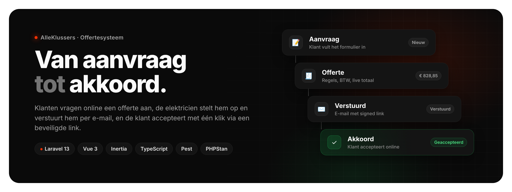
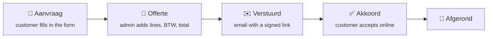
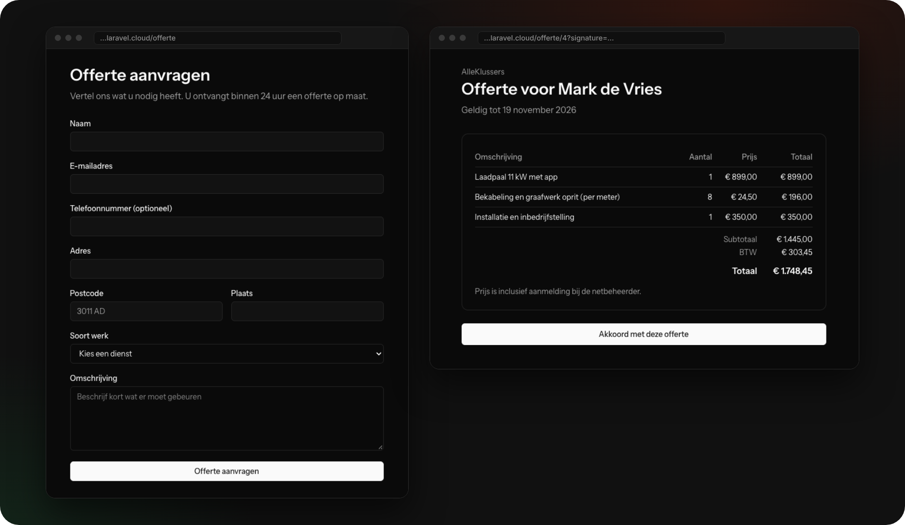
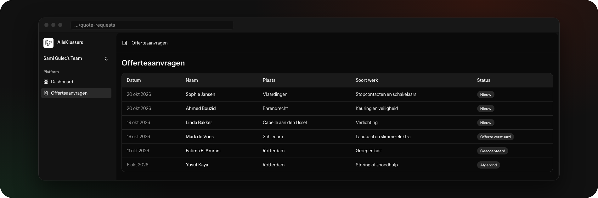
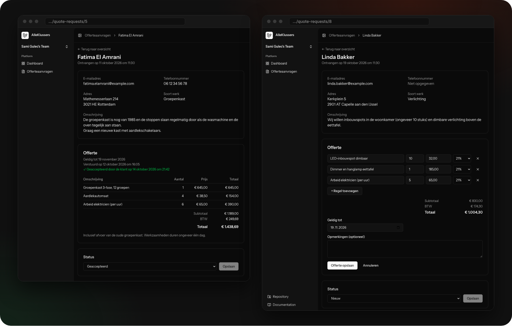
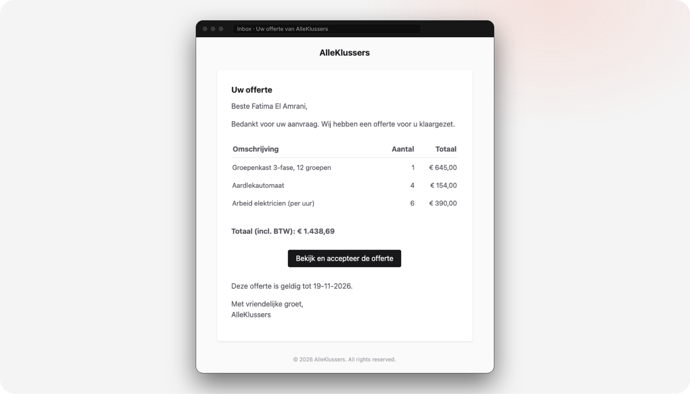
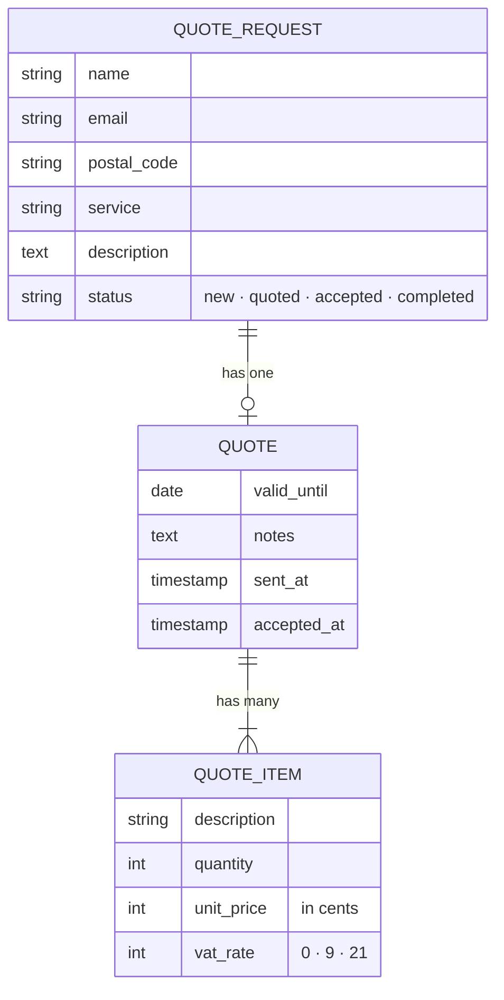

<p align="center">
  
</p>

<p align="center">
  <b>A quote system for a Dutch electrical contractor.</b><br>
  Customers request a quote online, the electrician builds and emails it, and the customer accepts it with one click.
</p>

<p align="center">
  <a href="https://github.com/samigulec/alleklussers-offerte/actions/workflows/tests.yml"></a>
  
  
  
  
  
  
  
</p>

<p align="center">
  <a href="https://alleklussers-offerte-production-wdfvyx.laravel.cloud/offerte"><b>Live demo</b></a> ·
  <a href="#-what-it-does">Features</a> ·
  <a href="#-screens">Screens</a> ·
  <a href="#-technical-decisions">Technical decisions</a> ·
  <a href="#-run-it-locally">Run locally</a> ·
  <a href="#-nederlands">Nederlands</a>
</p>

---

## ✨ What it does

Small contractors often handle quotes through WhatsApp, a Word template and a lot of back-and-forth. This app turns that
into one flow, from the first request to the customer's "akkoord":



<table>
<tr>
<td width="50%" valign="top">

### 👤 For the customer

- Public request form, no account needed
- Validation in Dutch, including the Dutch postcode format (`3011 AD`)
- The quote arrives by email with a button to view it
- One click on **Akkoord met deze offerte** to accept
- Expired quotes can't be accepted

</td>
<td width="50%" valign="top">

### 🛠 For the contractor

- Overview of all requests with their status
- Detail page with the customer's details and description
- Quote editor: add and remove lines, 0 / 9 / 21 % BTW, **live totals**
- Send the quote by email in one click
- Sees when the quote was sent and when it was accepted

</td>
</tr>
</table>

---

## 📸 Screens

<p align="center">
  <br>
  <sub><b>Customer side</b>: the request form and the quote the customer opens from the email</sub>
</p>

<p align="center">
  <br>
  <sub><b>Overview</b>: every request with its status, newest first</sub>
</p>

<p align="center">
  <br>
  <sub><b>Quote detail and editor</b>: an accepted quote on the left, a quote being edited with live totals on the right</sub>
</p>

<p align="center">
  <br>
  <sub><b>The email</b>: quote lines, total incl. BTW and a signed link to accept</sub>
</p>

---

## 🧠 Technical decisions

The parts I'd want to explain in a code review:

| Decision                                       | Why                                                                                                                                                                                             |
| ---------------------------------------------- | ----------------------------------------------------------------------------------------------------------------------------------------------------------------------------------------------- |
| **Money stored in cents** (`unsigned integer`) | Floats can't represent amounts like 0.10 exactly. `45000` is always € 450,00. Euros are only used for display (`Intl.NumberFormat`, `Number::currency`).                                        |
| **Totals are calculated, not stored**          | `subtotal()`, `vatAmount()` and `total()` live on the `Quote` model and are computed from the lines. Change a line and the total can't drift out of sync.                                       |
| **Signed URLs instead of customer accounts**   | The customer's link carries a signature (`URL::temporarySignedRoute`, `signed` middleware). Changing one character, or guessing another quote ID, gives a 403. The link expires with the quote. |
| **Accepting is idempotent**                    | Clicking **Akkoord** twice doesn't change anything the second time.                                                                                                                             |
| **Mass assignment protection**                 | `status` is not in `$fillable`, so a customer can't post `status=accepted`. A test proves it. The admin sets the status explicitly.                                                             |
| **Saving a quote in a transaction**            | Old lines are deleted and new ones created inside `DB::transaction()`. A failure halfway can't leave a quote without lines.                                                                     |
| **Eager loading**                              | `with('items')` loads a quote and its lines in two queries instead of one per line (no N+1).                                                                                                    |
| **Only the data the page needs**               | The customer's quote page gets the lines and totals, not the address, email or phone number.                                                                                                    |
| **Registration disabled in production**        | Only the contractor can log in. Public sign-up was switched off before going live.                                                                                                              |

### Data model



### Stack

|               |                                                                                                         |
| ------------- | ------------------------------------------------------------------------------------------------------- |
| **Back end**  | Laravel 13 (PHP 8.5): Eloquent relations, form validation with Dutch messages, Mailables, signed routes |
| **Front end** | Vue 3 + TypeScript via Inertia, Tailwind CSS, components from the Laravel Vue starter kit               |
| **Auth**      | Laravel Fortify (from the starter kit), public registration disabled                                    |
| **Database**  | SQLite locally, Serverless Postgres in production                                                       |
| **Quality**   | Pest feature tests, PHPStan (Larastan) level 7, Laravel Pint, Vite+ lint/format                         |
| **CI/CD**     | GitHub Actions runs all checks on every push; Laravel Cloud deploys `main` automatically                |

### Tests

Feature tests cover the whole flow, written with Pest:

- a customer can submit a request; an invalid postcode is rejected
- a customer **cannot** set the status through the form
- guests can't see the admin pages
- an admin can save a quote, and the totals are correct (`€ 555,00 + € 116,55 = € 671,55`)
- the quote email goes to the right customer
- a quote opens with a valid signature and returns **403** without one
- a customer can accept a quote; an expired quote can't be accepted

```bash
composer ci:check   # lint + format + types + PHPStan + all tests, the same checks CI runs
```

---

## 🚀 Run it locally

You need PHP 8.3+, Composer and Node.js 22. [Laravel Herd](https://herd.laravel.com) is the easiest way on macOS.

```bash
git clone https://github.com/samigulec/alleklussers-offerte.git
cd alleklussers-offerte
composer setup                              # installs everything, creates .env and the database
php artisan db:seed --class=DemoSeeder      # fictional demo requests and quotes
```

Registration is disabled, so create an admin account from the command line:

```bash
php artisan tinker --execute="App\Models\User::factory()->create(['email' => 'admin@example.com']);"
```

Then run `composer dev` and log in with `admin@example.com` / `password`. Emails are written to `storage/logs/laravel.log`;
open `/mail-preview/quote` to see the quote email in the browser.

---

## 🤖 How it was built

Built by **Sami Güleç** together with [Claude](https://claude.ai), AI-first: I decided what the system needed, wrote and
tested the code step by step, and used Claude as a pair programmer to explain Laravel concepts and review my work.
The [commit history](https://github.com/samigulec/alleklussers-offerte/commits/main) shows the system growing feature by
feature.

---

## 🇳🇱 Nederlands

**AlleKlussers Offertesysteem** is een offertesysteem voor een elektrabedrijf in de regio Rotterdam.

- Klanten vragen online een offerte aan, met validatie in het Nederlands (ook de postcode)
- In de beheeromgeving stelt de elektricien een offerte op met regels, BTW en live totalen
- De offerte gaat per e-mail naar de klant, die via een beveiligde (signed) link akkoord geeft
- Bedragen worden in centen opgeslagen, totalen worden berekend en nooit dubbel bewaard
- Feature tests met Pest, PHPStan level 7 en CI via GitHub Actions; live op Laravel Cloud

Gebouwd met Laravel 13, Vue 3, Inertia en TypeScript door Sami Güleç, AI-first samen met Claude.
